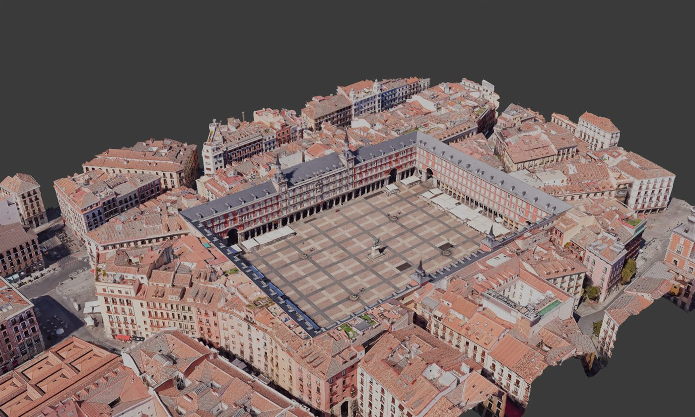
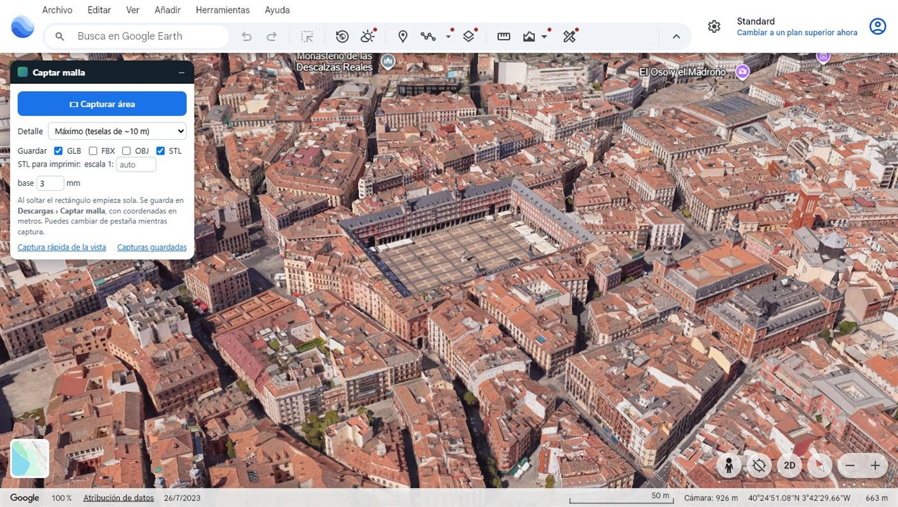
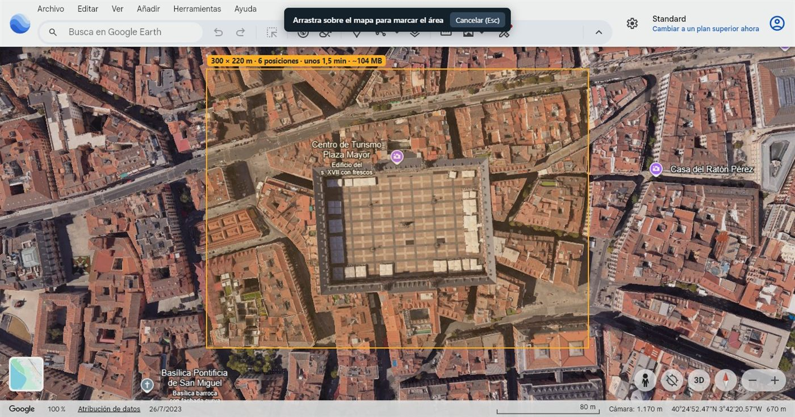
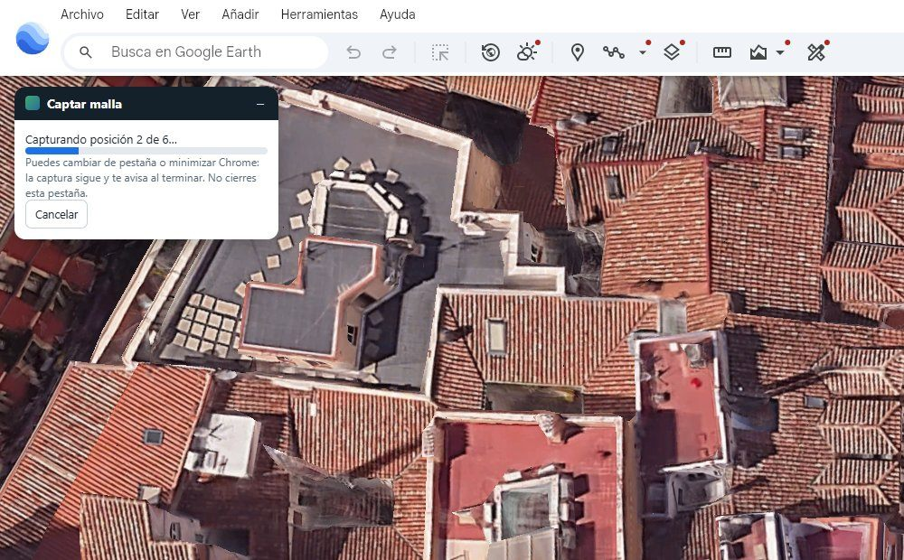
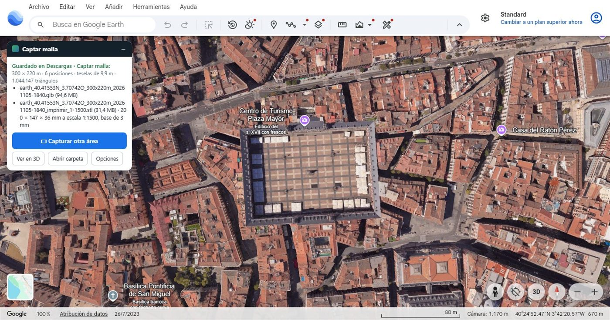
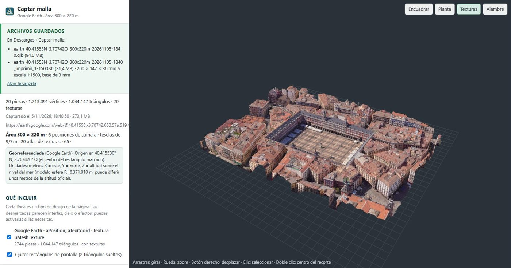
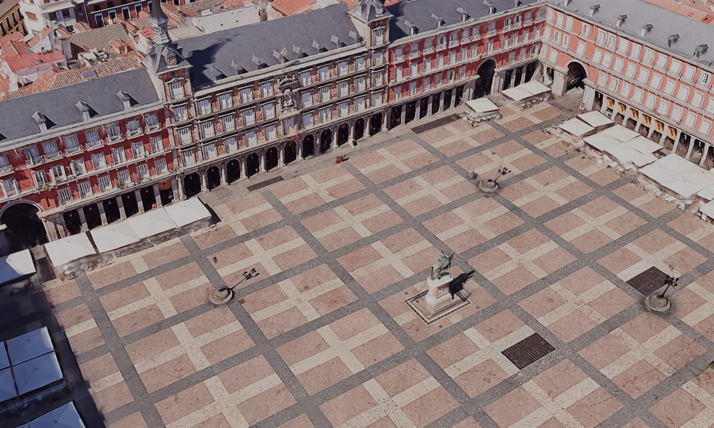
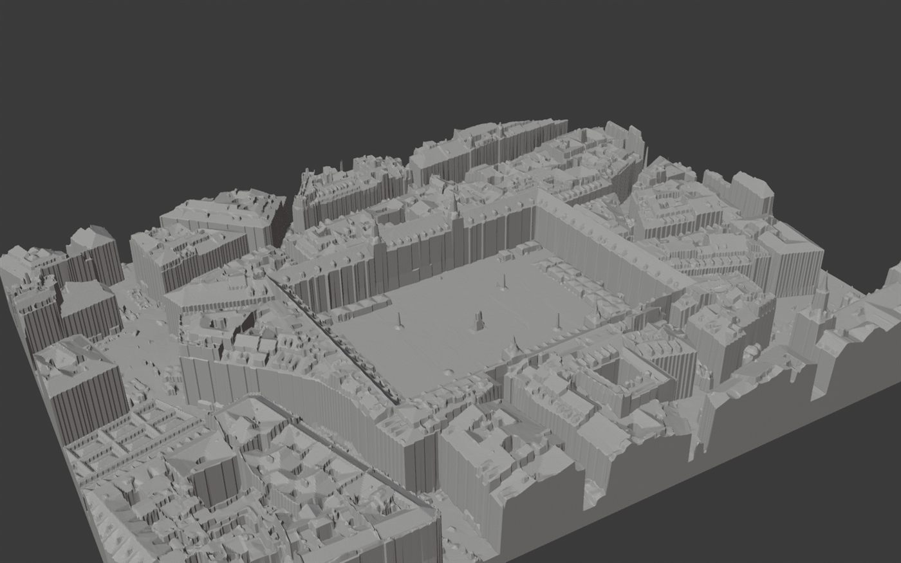
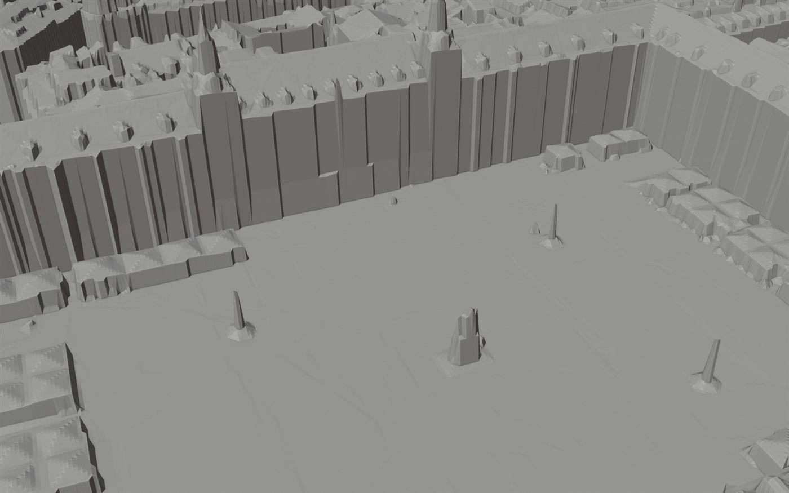

# Captar malla · Google Earth

**Marca un rectángulo en Google Earth y llévate su malla 3D**: con texturas y en metros (**GLB, FBX, OBJ**), o como **STL listo para imprimir**.

   

Plaza Mayor de Madrid, 300 × 220 m, capturada en 78 s con el detalle máximo y abierta en Blender (GLB, 1.044.000 triángulos, texturas a unos 4 cm por píxel).

## Qué hace

- **Un rectángulo y listo.** Arrastras sobre el mapa; al soltar, la extensión recorre la zona sola, posición a posición, con el **máximo detalle** que tiene Earth.
- **En segundo plano.** Puedes cambiar de pestaña o minimizar Chrome; al terminar te avisa.
- **Archivos útiles de verdad**:
  - en metros y con georreferencia;
  - texturas juntas en pocos atlas;
  - posiciones encajadas entre sí al milímetro;
  - guardado directo en `Descargas/Captar malla/`.
- **STL para imprimir:** sólido cerrado con base plana, en milímetros a escala.
- Sustituye el flujo manual de RenderDoc → `.rdc` → Blender (MapsModelsImporter) → exportar.

## Así se usa

| | |
|---|---|
|  |  |
| **1. El panel, dentro de Earth.** Elige detalle y formatos y pulsa **▭ Capturar área**. | **2. Arrastra el rectángulo.** Ves al momento su medida, las posiciones de cámara, el tiempo y el peso. Al soltar, empieza. |
|  |  |
| **3. Captura sola.** Mueve la cámara por la zona, con una vista de 3840 × 2400 para llegar al máximo detalle. Puedes irte a otra pestaña. | **4. Archivos guardados.** GLB y STL en *Descargas › Captar malla*; un clic para la siguiente área. |

## Resultados

| | |
|---|---|
|  |  |
| **Visor incluido**: revisa la captura y guarda en otro formato cuando quieras. | **Detalle**: fachadas, soportales, farolas y la estatua de Felipe III. |
|  |  |
| **STL para imprimir**: 200 × 147 × 36 mm a 1:1500, base de 3 mm. | **Sólido cerrado**: 0 aristas abiertas en Blender, listo para el programa de la impresora. |

### Cifras medidas (Madrid, Plaza Mayor)

| Área | Posiciones | Desde soltar hasta tener los archivos | Archivos |
|---|---|---|---|
| 300 × 220 m | 6 | 78 s (GLB + STL) | GLB 94,6 MB · STL 31,4 MB |
| 297 × 166 m, primera vez en la zona | 4 | 66 s (GLB + STL) | GLB 77 MB · STL 23,5 MB |
| 297 × 166 m, otra vez en la misma zona | 4 | 39 s (GLB + STL) | Igual |
| 133 × 89 m | 1 | 32 s (GLB + STL) | GLB 17 MB · STL 22,6 MB |

- Casi todo el tiempo es la descarga de Earth: unas 2.000 teselas por posición. Con otra conexión, las cifras cambian.
- Los GLB pasan el validador oficial de Khronos sin errores.
- Detalle de cada prueba en [REGISTRO.md](REGISTRO.md).

## Instalar

1. Descarga este repositorio (**Code › Download ZIP**) y descomprímelo, o clónalo.
2. En Chrome, abre `chrome://extensions` y activa **Modo de desarrollador**.
3. Pulsa **Cargar descomprimida** y elige la carpeta `extension`.
4. Abre `earth.google.com/web`: a la izquierda aparece el panel **Captar malla**.

La primera vez en cada pestaña, la página se recarga para engancharse y Chrome muestra el aviso amarillo de depuración: es normal.

Guía completa, opciones y solución de problemas: **[LEEME.md](LEEME.md)**.

## Cómo funciona

- Se engancha a la pestaña de Earth con `chrome.debugger`, como DevTools, y registra la geometría, las matrices y las texturas de WebGL de cada fotograma (`extension/hook.js`).
- Mueve la cámara por una cuadrícula de posiciones cenitales (`extension/lib/earth.js`).
  - Espera a cada posición siguiendo los dibujos del globo y las peticiones de teselas.
  - El foco emulado y la retransmisión de la pestaña mantienen a Earth dibujando aunque esté oculta.
- Encaja las posiciones entre sí con las teselas que comparten, y las recorta sin huecos ni repetidos (`extension/lib/decode.js`).
- Exporta con atlas de texturas. El STL se rehace como relieve en rejilla con paredes y base, comprobado como malla cerrada (`extension/lib/exporters.js`).

Todo ocurre en el propio equipo: la extensión no envía nada a internet.

## Carpetas

| Carpeta | Contenido |
|---|---|
| `extension/` | La extensión (lo que se carga en Chrome) |
| `pruebas/` | Pruebas automáticas con un Chrome de perfil temporal (`npm install` dentro de la carpeta). `capturas_readme.mjs` rehace las capturas de esta página |
| `docs/img/` | Imágenes de esta página |

## Condiciones de uso

**Las condiciones de servicio de Google Earth limitan copiar y reutilizar su contenido.**
- Esta herramienta está pensada como referencia de trabajo.
- Quien la use es responsable de respetar esas condiciones.
- La vía oficial de Google para usar sus modelos 3D es la API *Photorealistic 3D Tiles*.

Las imágenes de esta página muestran Google Earth y datos 3D © Google y sus proveedores, solo para ilustrar la herramienta.

Incluye [three.js](https://threejs.org/) (licencia MIT, `extension/lib/three.LICENSE.txt`).
